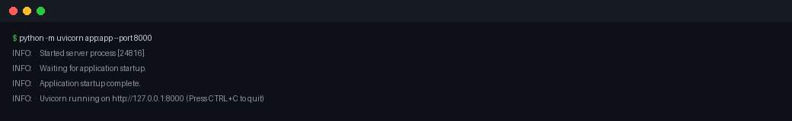

# Gatekeeper


Middleware ASGI de seguridad para FastAPI/Starlette. Una capa extra delante de tu
app: rate limiting, cabeceras seguras, detección de patrones de ataque en query y
body, reglas propias por YAML y auditoría en JSON.

```bash
pip install gatekeeper-asgi             # núcleo
pip install "gatekeeper-asgi[yaml]"     # + configuración por YAML
pip install "gatekeeper-asgi[redis]"    # + rate limit compartido entre workers
```

```python
from fastapi import FastAPI
from gatekeeper import Config, GatekeeperMiddleware

app = FastAPI()
app.add_middleware(GatekeeperMiddleware, config=Config(rate_limit=100, rate_window=60))
# o con Redis para que todos los workers cuenten lo mismo:
# Config(rate_backend="redis", redis_url="redis://localhost:6379/0")
# o: Config.from_yaml("gatekeeper.yaml")   (ver examples/gatekeeper.yaml)
```

## Qué cubre

| Protección | Detalle |
|---|---|
| Rate limiting | Ventana deslizante por IP. En memoria (un proceso) o en Redis con script Lua atómico (compartido entre workers), vía `redis.asyncio`, sin bloquear el event loop |
| Cabeceras | nosniff, X-Frame-Options, HSTS, Referrer-Policy, Permissions-Policy (no pisa las de tu app) |
| SQLi | UNION SELECT, tautologías (`' OR '1'='1`, `?a=1=1`), consultas apiladas (`; DROP`), time-based (`sleep()`, `WAITFOR DELAY`), error-based (`EXTRACTVALUE`, `CONVERT`), sondeo de columnas (`ORDER BY 10`) |
| XSS | `<script>`, handlers de evento con y sin etiqueta (`onerror=`, ` onload=`), `javascript:`, `data:text/html`, con doble codificación |
| Path traversal | `../`, `..\`, `..;/`, con decodificación repetida y frontera de segmento (`foo../x` no es un salto) |
| Ficheros sensibles | `/etc/passwd`, `shadow`, `subuid`; `/proc/self/environ`; `win.ini`; `.ssh/id_*`; `.aws/credentials`; `.docker/secrets`; `.git/config`; `.env` (exigen separador: `?q=.env` pasa) |
| NoSQL | Operadores de inyección Mongo: `$ne`, `$nin`, `$where`, `$regex` en JSON o corchetes (`user[$ne]=x`). `$gt`/`$lt`/`$in` quedan fuera: los usan los filtros legítimos |
| Comandos del sistema | Separador shell + binario (`; ls`, `\| cat`, `&& whoami`, `$(id)`, `` `uname` ``), LOLBins de Windows (`powershell.exe`), webshells PHP (`;system('`, `shell_exec(`), reverse shell `/dev/tcp/` |
| SSRF | Metadata cloud (AWS/GCP/Azure/Alibaba) y esquemas de lectura local (`file://`, `gopher://`, `dict://`, `jar://`); `localhost` no bloquea (OAuth de desarrollo) |
| SSTI | Aritmética de plantillas (`{{7*7}}`, `${7*7}`, `<%= 7*7 %>`, `#{7*7}`) y objetos peligrosos (`config`, `self`, `__class__`, `__subclasses__`) |
| CRLF | Salto de línea seguido de cabecera: response splitting e inyección de cabeceras (CRLF real o `\r\n` literal) |
| Log4Shell | `${jndi:ldap://…}` con sus ofuscaciones (`${${::-j}ndi:`) y lookups de exfiltración (`${env:AWS_SECRET…}`) |
| Proto-pollución | `__proto__` en cualquier posición y `constructor.prototype` |
| Evasiones | URL-encoding repetido (3 rondas), escapes IIS `%uXXXX` mayúsculas o no, ancho completo (`＜script` vía NFKC), comentarios SQL `/**/` y versionados (`/*!50000union*/`), entidades HTML numéricas **y nombradas** (`&lt;script`), tab/NL dentro del esquema (`java\tscript:`) |
| Límite de body | `max_body_size` (1 MiB por defecto) → 413, también sin `Content-Length` |
| Reglas propias | Regex en YAML o `Config(custom_rules=...)`, validadas al arrancar |
| Exclusión de rutas | `allow_paths` (globs). Rutas con `..`, `\` o codificación residual nunca se eximen |
| Auditoría | Eventos JSON en el logger `gatekeeper`; **nunca** incluye el contenido del payload |
| Modo monitor | `monitor_only=True` registra sin bloquear, para medir falsos positivos en tu tráfico real |

## Qué mide (no qué promete)

Se miden dos corpus. El primero es nuestro, redactado y con procedencia
documentada ([corpus/](corpus/)):

| Métrica (corpus propio) | Valor |
|---|---|
| Ataques detectados | 131 / 131 (**100.0%**) |
| Falsos negativos sin documentar | 0 |
| Peticiones legítimas bloqueadas sin documentar | **0** / 72 |
| Falsos positivos documentados (límites aceptados) | 5 |
| Falsos negativos documentados (límites aceptados) | 0 |

Once familias de detección: SQLi, XSS, path traversal, ficheros sensibles, NoSQL,
comandos del sistema, SSRF, SSTI, CRLF, Log4Shell y proto-pollución. El
desglose con la frontera de falsos positivos de cada una está en
[docs/amenazas.md](docs/amenazas.md).

El segundo es **ajeno**: los tests de regresión de
[OWASP Core Rule Set](https://github.com/coreruleset/coreruleset) (Apache-2.0,
commit `30cb436`, importado con `tools/import_crs.py`), que escribió otra gente
para otro WAF, con sus propios negativos:

| Métrica (corpus externo CRS, familias 930/941/942) | Valor |
|---|---|
| Tests importados | 1379 (1135 en alcance, 12 excluidos y declarados) |
| Ataques detectados | 238 / 1135 (**21.0%**) |
| Negativos de CRS bloqueados (FP) | 9 / 232 (3.9%) |

Ese 21.0% no es una meta: es la **línea base** de un corpus diseñado para un
WAF de 500+ reglas y payloads mucho más ofuscados, y el workflow la vigila para
que no baje. Publicarlo entero es el punto: un 100% propio y un 21.0% ajeno, los
dos medidos y los dos con guarda en CI.

El detalle, incluidos los payloads que se escapan y por qué, está en
[corpus/REPORT.md](corpus/REPORT.md). El workflow falla si una regla nueva
empeora esas cifras (`python tools/evaluate.py --check`).

## Demo

Una sesión real contra [`demo/app.py`](demo/) (uvicorn + curl, sin trucos):
tráfico normal pasa, los payloads reciben 403 y la auditoría registra la
regla, el campo y el patrón que saltó — nunca el contenido.



La app de la demo incluye un playground con botones y configs de despliegue
para Vercel (`vercel --prod`) y Docker: [`demo/`](demo/).

## Latencia

`python benchmarks/latency.py` mide el coste por petición en tu máquina
(Python 3.14, portátil, sin red):

| Escenario | p50 | p95 | p99 | +p50 vs base |
|---|---|---|---|---|
| sin middleware (base) | 12.30 | 19.60 | 27.50 | — |
| solo cabeceras | 29.30 | 46.70 | 65.90 | +17.00 |
| inspección (query + cabeceras + body) | 85.70 | 117.60 | 185.90 | +73.40 |
| rate limit solo | 30.60 | 37.80 | 54.40 | +18.30 |
| completo (inspección + rate limit) | 88.30 | 123.20 | 149.20 | +76.00 |
| request atacante (403 temprano) | 62.70 | 88.10 | 115.40 | +50.40 |

**Por qué p95 y no la media.** Hasta 0.3.1 el benchmark publicaba la media por
ronda, y esa cifra escondía justo lo que un usuario nota: la cola. El mismo
escenario «completo» que la media rondaba los ~90 µs tiene un **p95 de 123 µs y
un p99 de 149 µs**; una pausa puntual del recolector de basura puede llevar una
petición aislada a 500–1500 µs, y con 7500 muestras esa cola existe. Medir el
percentil 95 de la distribución real es lo que permite poner una guardia útil.

`python benchmarks/latency.py --check` es la **guarda de regresión** que corre en
CI: si algún escenario con presupuesto se pasa del umbral, el pipeline falla.
Usa el **mejor p95 de tres rondas** a propósito — el ruido del sistema solo sube
el percentil, así que el mínimo es la estimación más cercana al coste real
del código y evita falsos positivos por una pausa del garbage collector (que sí
los producía: con una sola ronda el guard fallaba de forma intermitente). Los
umbrales viven en `CHECK_BUDGET_US` con su margen justificado; subirlos es una
decisión que se documenta en el PR, no un número que sube en silencio.

Las cifras de la tabla son de **una** ejecución en una máquina concreta
(portátil, sin red, Python 3.14). Entre ejecuciones varían — razón por la que
el guard no las compara con un valor fijo, sino con un presupuesto con margen.
Lo reproducible es la comparación entre escenarios de una misma corrida.

## Documentación

Guía completa con [MkDocs Material](https://squidfunk.github.io/mkdocs-material/)
en [`docs/`](docs/): uso, detección y medición, modelo de amenazas, seguridad,
referencia de API y desarrollo. En local: `mkdocs serve`. Se publica en
<https://eche-dev.github.io/Gatekeeper/> en cada push a `main` (build
`--strict` en CI: un enlace roto rompe el workflow).

Contribuir: [CONTRIBUTING.md](https://github.com/Eche-Dev/Gatekeeper/blob/main/CONTRIBUTING.md)
· [Código de conducta](https://github.com/Eche-Dev/Gatekeeper/blob/main/CODE_OF_CONDUCT.md)
· Plantillas de issues y PR en la raíz del repo.

## Qué NO cubre

- La detección por regex tiene falsos positivos y falsos negativos: **no sustituye**
  a consultas parametrizadas, a validación de entradas ni a un WAF.
- `multipart/form-data` y bodies binarios no se inspeccionan (las subidas de archivos pasan intactas; parser en v0.4).
- Cada valor del body se analiza por separado: un ataque repartido en varios campos no se detecta.
- Los operadores `$gt`/`$lt`/`$in` de Mongo quedan fuera de la firma NoSQL a propósito (los usan los filtros legítimos); `localhost` y `127.0.0.1` no cuentan como SSRF (OAuth de desarrollo).
- Con `rate_backend="memory"` y varios workers, el límite efectivo se multiplica: usa Redis.
- Si Redis no responde, `rate_fail_open=True` (por defecto) sigue admitiendo peticiones; ponlo a `False` si prefieres 503.
- `trust_proxy=False` por defecto; actívalo solo detrás de un proxy de confianza. Con `trust_proxy=True` el XFF se lee de derecha a izquierda (`ips[-trusted_proxies]`); añade `trusted_proxy_cidrs` si la app es alcanzable por otro camino.
- Un body JSON/form mayor que `max_body_size` se rechaza: súbelo o usa `inspect_body=False`.
- `allow_paths` exime de inspección, no de rate limit ni de bloqueo de IP.

## Configuración

| Opción | Por defecto | Descripción |
|---|---|---|
| `rate_limit` / `rate_window` | `100` / `60` | peticiones permitidas por IP y ventana (0 desactiva) |
| `rate_backend` | `memory` | `memory` o `redis` |
| `redis_url` / `redis_prefix` | `redis://localhost:6379/0` / `gatekeeper:rl:` | conexión y prefijo de claves |
| `rate_fail_open` | `True` | política si Redis no responde: admitir o 503 |
| `inspect_requests` / `inspect_body` | `True` | inspección de query y de body |
| `monitor_only` | `False` | registrar sin bloquear |
| `disabled_rules` | `∅` | `sqli`, `xss`, `path_traversal`, `sensitive_files`, `nosql`, `cmdi`, `ssrf`, `ssti`, `crlf`, `log4shell`, `proto_pollution` o tus reglas |
| `rule_packs` | `∅` (todas) | packs opt-in: `minimal`, `api`, `web`, `infrastructure`, `strict` (ver abajo) |
| `exclude_fields` | `[]` | campos (parámetro, cabecera o puntero JSON) exentos de inspección; admite globs |
| `custom_rules` | `∅` | `{nombre: regex}` o lista `{name, pattern}` |
| `max_body_size` | `1 MiB` | límite del body inspeccionado |
| `allow_paths` | `[]` | globs exentos de inspección |
| `inspect_headers` | `user-agent, referer, cookie, x-forwarded-for` | cabeceras inspeccionadas (`∅` desactiva) |
| `blocked_ips` / `trust_proxy` | `∅` / `False` | bloqueo por IP o CIDR y uso de `X-Forwarded-For` |
| `trusted_proxies` / `trusted_proxy_cidrs` | `1` / `∅` | hops de proxy a saltar en el XFF y redes de las que se cree |
| `security_headers` | ver fuente | `None` = cabeceras por defecto |

`Config` falla al arrancar, no en producción: claves desconocidas (un typo como
`rate_limt`), regex inválidas o vacías, nombres duplicados, `disabled_rules`
inexistentes y packs desconocidos lanzan `ValueError`.
Las reglas propias se evalúan sobre texto **decodificado, sin comentarios `/**/` y
en minúsculas**; evita patrones con backtracking catastrófico, los patrones
propios no están acotados por Gatekeeper.

## Packs de reglas

Las once familias se evalúan por defecto. Si tu app expone menos superficie de
la que asumes, puedes activar un subconjunto (los packs son **opt-in**: sin
`rule_packs` no cambia nada respecto a lo que ya hacía Gatekeeper).

| Pack | Familias | Para qué |
|---|---|---|
| `strict` | las once | defecto explícito; apps que sirven HTML de terceros |
| `web` | + `xss` sobre `api` | web pública con HTML (el pack que casi todos quieren) |
| `api` | `sqli`, `nosql`, `path_traversal`, `sensitive_files`, `ssrf`, `log4shell`, `crlf`, `cmdi` | APIs JSON/GraphQL: sin `xss`, `ssti` ni `proto_pollution` porque no hay plantilla que renderizar |
| `minimal` | `sqli`, `path_traversal` | solo lo que no depende de la superficie expuesta |
| `infrastructure` | `ssrf`, `log4shell`, `crlf`, `cmdi` | segunda capa tras un WAF, o backend sin SQL |

```python
from gatekeeper import Config

Config(rule_packs=["api"], disabled_rules=["cmdi"])   # API sin XSS ni SSTI, sin cmdi
```

Un pack desconocido es `ValueError` al arrancar: una app no puede quedarse sin
protección porque alguien escribiera `rule_packs=["we"]`.

## Excluir campos (y no campos)

Cuando tu app acepta por diseño un valor que una firma bloquea (un buscador que
indexa documentación de seguridad, un parámetro `template` con Jinja, un
webhook), exímeno **ese campo**, no la familia entera:

```python
Config(exclude_fields=["template", "bio", "doc_*"])
```

Funciona en los tres transportes: parámetro de query, cabecera (`user-agent`)
y puntero JSON (`/user/bio` o solo `bio`). La detección que cruza varios campos
se conserva: si excluyes `a` pero el payload está repartido entre `a` y `b`,
Gatekeeper quita `a` del objetivo y sigue vigilando `b`. La alternativa es
`disabled_rules`, que apaga la familia para toda la app.

## `gatekeeper report`: mide antes de bloquear

Poner el middleware delante en `monitor_only=True`, dejar correr el tráfico real
y mirar qué salta:

```bash
monitor_only: true      # en tu configuración, mientras tanto
gatekeeper report gatekeeper.log          # ranking de reglas, rutas y campos
gatekeeper report gatekeeper.log --json   # salida legible por máquina
```

El informe agrupa por (regla, campo) —lo que se repite es ruido— y propone un
`exclude_fields` o un `disabled_rules` listo para copiar. Acepta el JSON que
emite el logger de Gatekeeper o un log de acceso genérico
(`GET /ruta?q=... 200`). Los eventos de auditoría no incluyen el contenido del
payload, así que este informe tampoco puede filtrar lo que el log no trae.

## Desarrollo

```bash
pip install -e ".[dev]"
ruff check .            # estilo
mypy                    # tipos estrictos (src/gatekeeper)
bandit -r src -q        # análisis estático de seguridad
pytest --cov=gatekeeper   # incluye fuzzing con hypothesis (tests/test_fuzz.py)
python tools/evaluate.py --check     # tasas de detección y FP (propio + CRS)
python tools/import_crs.py --check   # procedencia del corpus externo
python benchmarks/latency.py         # coste por petición
python -m build && twine check dist/*   # el paquete se puede publicar
```

## Proyecto

- [CHANGELOG.md](CHANGELOG.md) — qué cambia en cada versión.
- [SECURITY.md](SECURITY.md) — modelo de amenazas, límites y cómo reportar fallos.
- [corpus/REPORT.md](corpus/REPORT.md) — informe de detección generado.

Licencia MIT.
